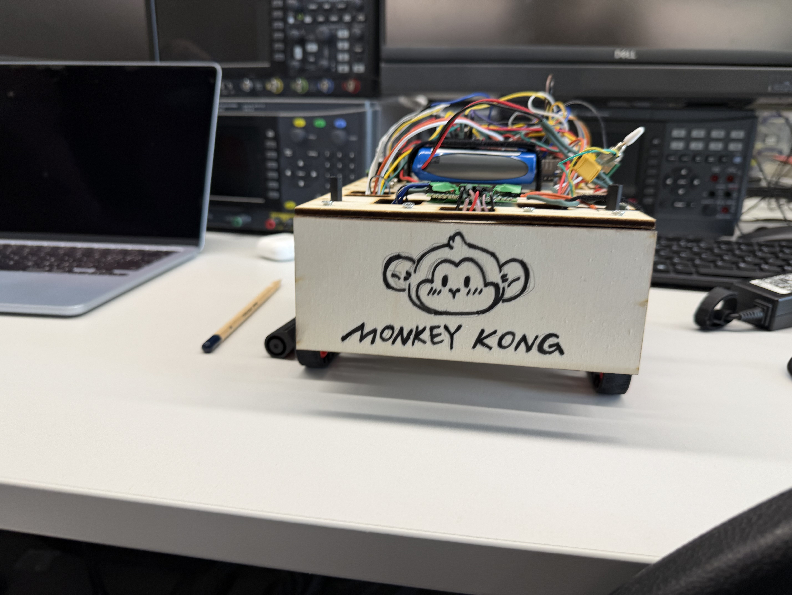
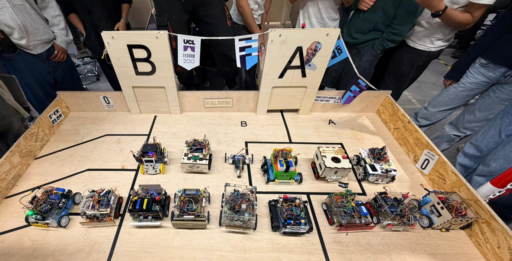
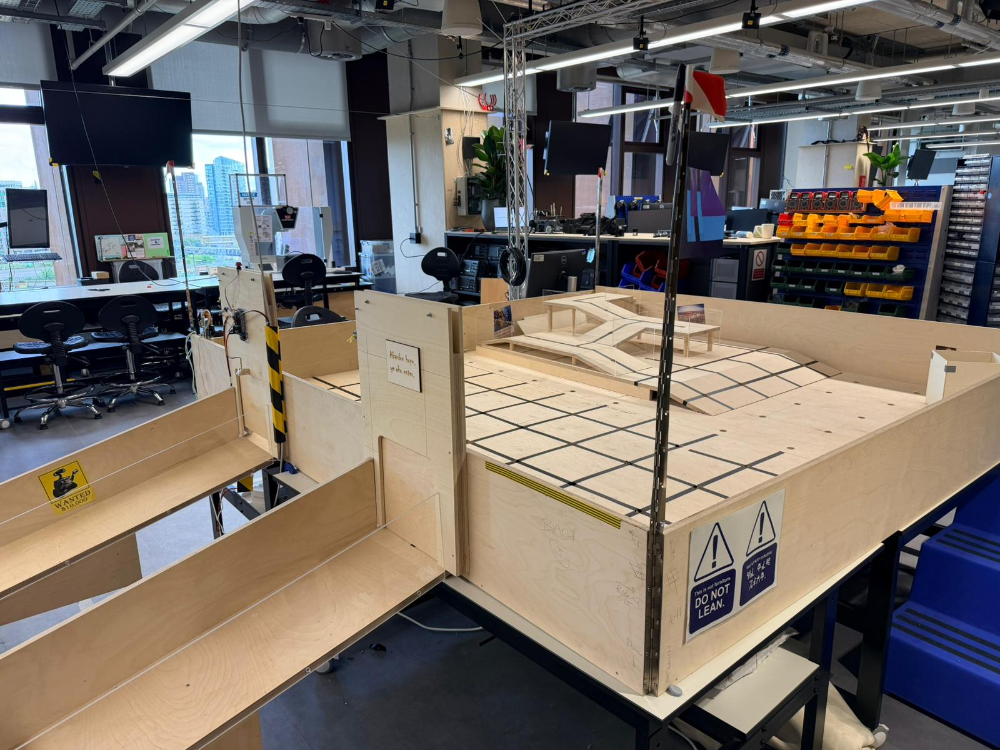
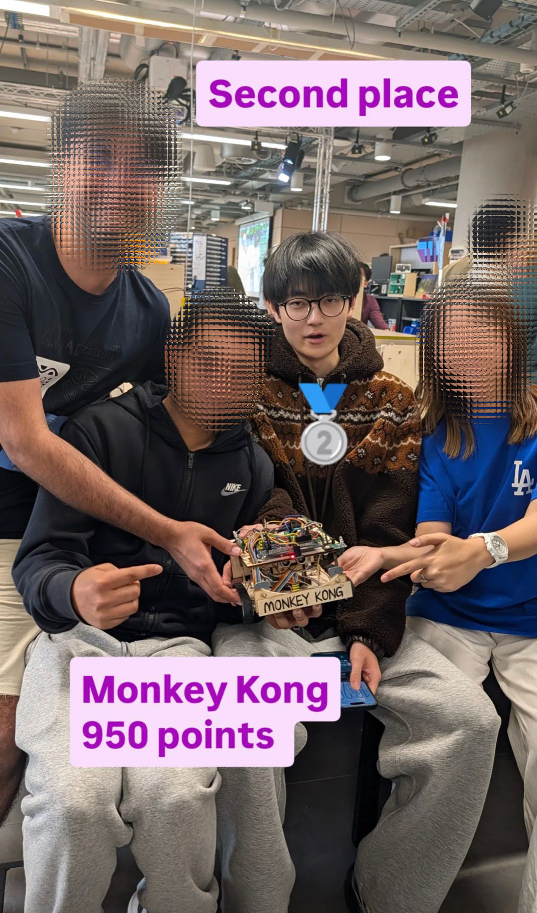

# Lunar Agriculture Robot

### UCL Robotics Challenge 2026

**🏆 2nd Place out of 14 Teams | 950 Competition Points**

**April – June 2026 | University College London (UCL)**

---

## Project Overview

The Lunar Agriculture Robot is an autonomous seeding rover
developed by a four-member team of Robotics and Artificial
Intelligence students at University College London.

Designed for the UCL Robotics Challenge 2026, the rover
integrates autonomous navigation, sensor-based control,
seed planting and safety mechanisms into a unified robotic
system.

Our team achieved **2nd place among 14 competing teams**,
scoring **950 points** based on competition performance.

This portfolio showcases the completed robot, competition
footage, development process and my individual technical
contributions.

---

## Video Demonstrations

### 🎬 Cinematic Project Showcase

A cinematic highlight video presenting the robot, its
design and key moments from the project.

**[▶ Watch the Robot in Action](https://youtu.be/srIqk2yGY40)**

### 🎥 Live Competition Footage

Original footage recorded during the UCL Robotics
Challenge, showing the rover operating in the actual
competition environment.

**[▶ Watch Live Competition Footage](https://youtube.com/shorts/9PKAt54Yfks?feature=share)**

---

## Project Gallery

### 1. Our Robot — Final Prototype

Our team's autonomous agricultural rover, developed
to navigate the competition environment and perform
seed-planting tasks.

### 2. Competition Robots

A collection of robots developed by participating teams
in the UCL Robotics Challenge 2026, showcasing the
diverse engineering designs and approaches adopted
throughout the competition.

### 3. Competition Environment

The competition arena where autonomous navigation,
sensor-based control and seed-planting capabilities
were tested under real competition conditions.

### 4. Project Team

Our four-member project team participated in the
UCL Robotics Challenge 2026, achieving 2nd place
out of 14 teams with a final score of 950 points.

---

## My Role & Contributions

**Role: Primary Software Contributor**

As the primary software contributor, I developed the
rover's core control framework and contributed to
system integration, testing and debugging across
hardware and software components.

### Core Control Architecture
- Developed the main embedded C++ control framework
  on the Arduino GIGA R1 WiFi.
- Integrated navigation, sensing, seed planting and
  safety functionality using a non-blocking
  finite-state-machine architecture.

### Autonomous Navigation
- Implemented PID-based line following and
  PD-based wall following.
- Developed gyroscope-based turning logic for
  accurate 90-degree turns and U-turns.
- Integrated multiple sensor inputs to support
  autonomous navigation.

### Safety & Reliability
- Designed emergency-stop and state-preserving
  pause/resume logic.
- Enabled the rover to interrupt tasks and resume
  operation without restarting the entire sequence.

### Testing & System Integration
- Led integration testing and debugging across
  sensors, motors and software.
- Analysed sensor data to calibrate detection
  thresholds and tune control parameters.
- Identified and resolved hardware-software
  integration issues during development and testing.

---

## Technical Highlights

| Category | Technologies |
|---|---|
| Microcontroller | Arduino GIGA R1 WiFi |
| Programming | Embedded C++ |
| Control | PID / PD Controllers |
| Architecture | Finite State Machines |
| Sensors | IR Array, Ultrasonic, Gyroscope, Encoders, RFID |
| Development | Sensor Calibration, System Integration, Testing & Debugging |

---

## Competition Results

| Metric | Result |
|---|---|
| Competition | UCL Robotics Challenge 2026 |
| Team Size | 4 Members |
| Final Ranking | 2nd / 14 Teams |
| Team Score | 950 Points |
| Winning Score | 1050 Points |

The final result reflects the team's combined efforts
in mechanical development, software engineering,
system integration and competition preparation.

---

## Original Team Repository

The original source code and technical development
files are available in the team's project repository:

**[View Original Team Repository](https://github.com/ZhichengCia/Term3-project)**

---

## Acknowledgements

This project was completed collaboratively by a
four-member team at University College London.

This portfolio highlights my individual contributions
while recognising the collective work and achievements
of the entire team.
# Lunar-Agriculture-Robot
Autonomous seeding rover | UCL Robotics Challenge 2026 | 2nd Place
